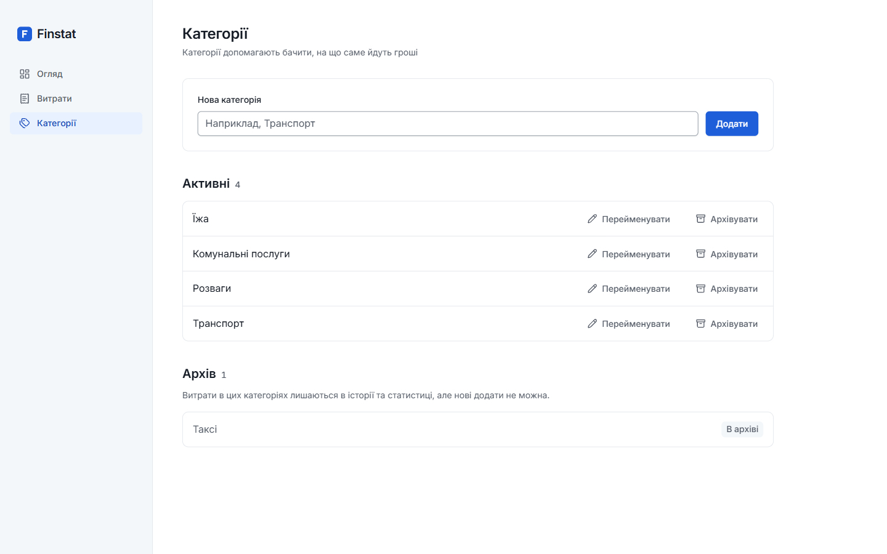
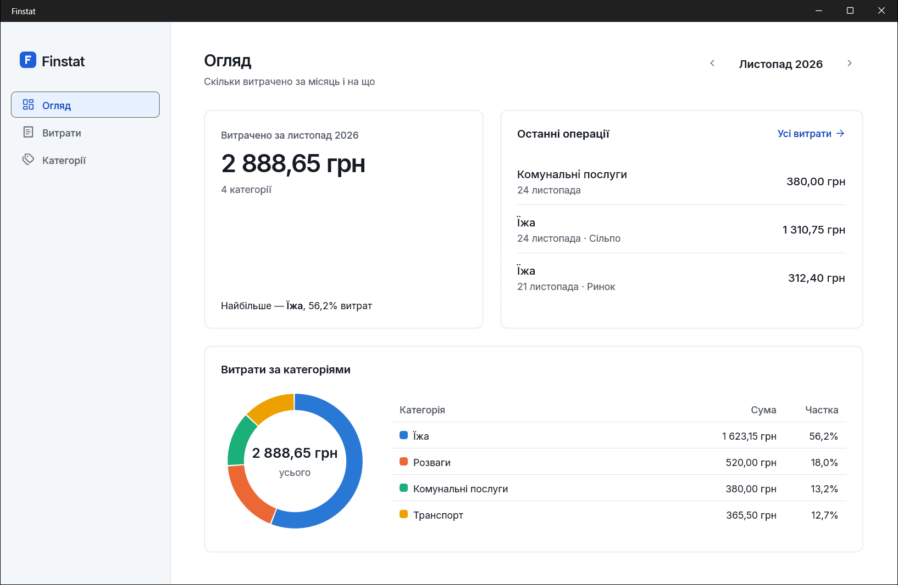
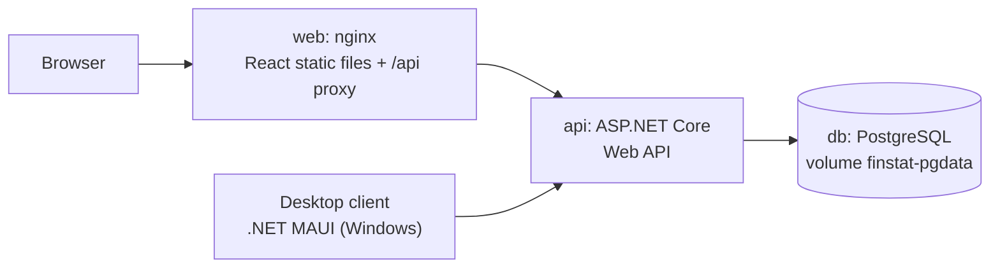
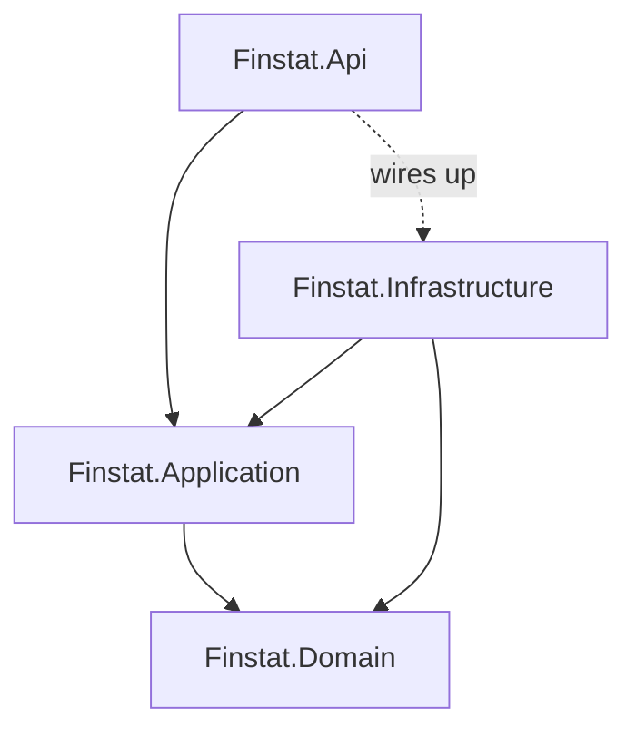

# finstat

A personal expense tracker (MVP, university project). You record expenses by hand, sorted into categories, and the app shows a chart and a table of how much you spent in a month and on what. The UI is in Ukrainian; code and commits are in English. Design decisions are in `docs/`.

## Features

- Add, edit and delete expenses: amount in hryvnias, category, date (today by default), optional comment.
- Manage your own categories: add, rename, archive. An archived category stays in history and statistics, but new expenses can't be recorded in it.
- Browse any month: total, top spending category, three latest transactions, a donut chart of category shares and a table of totals per category.

## Screenshots

**Overview**: monthly total, latest transactions, category shares:


**Expenses**: the form and the list for the selected month:


**Categories**: active and archived:



The **desktop client** (Windows, .NET MAUI) has the same screens: `docs/screenshots/desktop-overview.png`, `desktop-expenses.png`, `desktop-categories.png`.



## Run with one command

You only need Docker (Docker Desktop on Windows and macOS).

Once, copy `.env.example` to `.env` and set `POSTGRES_PASSWORD` in it (cmd: `copy .env.example .env`; PowerShell and bash: `cp .env.example .env`). After that the whole app starts with one command:

```
docker compose up --build
```

The password must not contain `;` or `'`: it is inserted into the connection string. The first image build takes a few minutes.

App: http://localhost:3000. API: http://localhost:8080 (`/health`). PostgreSQL data lives in the named volume `finstat-pgdata` (Docker prefixes it with the project name taken from the folder, e.g. `finstat_finstat-pgdata`), so data survives restarting and recreating the containers.
Stop: `docker compose down`. The `-v` flag deletes the data, so use it only on purpose.
Host ports are changed with `WEB_PORT`, `API_PORT` and `DB_PORT` in `.env` (if port 5432 is taken by a local PostgreSQL, set e.g. `DB_PORT=5433`).

On first start the categories «Їжа» (Food) and «Комунальні послуги» (Utilities) already exist.

## Architecture



The browser talks only to `web`: the same origin serves the UI and proxies `/api/` to the backend, so CORS isn't needed. The desktop client calls the API directly; only browsers enforce CORS, so the backend doesn't change for it either.

### Backend: DDD layers



- **Domain**: the model and rules, with no external dependencies. Aggregates `CategoryEntity` and `ExpenseEntity`; an expense references its category by id. The amount is a `decimal`, validated in `ExpenseEntity`: positive only, at most two decimal places; extra precision is rejected with an error, not rounded. State changes only through methods (`Rename`, `Archive`, `Change`); there are no public setters.
- **Application**: use cases `CategoryService`, `ExpenseService`, `StatisticsService`. This is where, for example, category name uniqueness is checked and a new expense is kept out of an archived category. The storage interfaces (`ICategoryRepository`, `IExpenseRepository`) are declared here too.
- **Infrastructure**: EF Core (Npgsql), mapping configuration, migrations and the interface implementations. Monthly statistics are aggregated in SQL, without loading every expense.
- **Api**: controllers under `/api` (`categories`, `expenses`, `statistics`), explicit DTOs, errors as Problem Details. Controllers call use cases and hold no business rules.

### Frontend

React + TypeScript (strict) + Vite. Code is grouped by app section: `features/overview`, `features/expenses`, `features/categories`. The app shell is in `app/`, shared utilities (dates, money, selected month) in `shared/`, in-house components with no third-party UI library in `ui/`, the API client in `api/`. Money stays an exact decimal string on the frontend and is formatted with `Intl.NumberFormat('uk-UA')`; totals and shares are computed by the backend. More: `frontend/README.md`.

### Desktop client

.NET MAUI for Windows, native XAML controls. View models, the API client and formatting live in `Finstat.Desktop.Core`, which doesn't depend on MAUI and is covered by tests. Amounts arrive as strings and are only formatted; totals and shares are computed by the backend. More: `docs/technical-decisions.md`.

## Backend layout (`backend/`)

- `src/Finstat.Domain`: `Entities/`, `Results/`, entities and invariants with no external dependencies.
- `src/Finstat.Application`: `Services/`, `DTOs/`, `Repositories/`, use cases (depends on Domain).
- `src/Finstat.Infrastructure`: `Repositories/`, `Configurations/`, EF Core (Npgsql), `FinstatDbContext`, migrations.
- `src/Finstat.Api`: `Controllers/`, `Helpers/`, controllers, Problem Details, `/health`.

## Desktop layout (`desktop/`)

- `src/Finstat.Desktop.Core`: `DTOs/`, `Api/`, `Formatting/`, `ViewModels/`, the API contract, an `HttpClient`-based client, `uk-UA` formatting, view models.
- `src/Finstat.Desktop`: the MAUI app, `MainPage` with the menu, `Views/` (Overview, Expenses, Categories), `Controls/` (donut chart, month switcher, states), `Resources/` (colours, styles, Inter font, icons).
- `tests/Finstat.Desktop.Tests`: xUnit v3; formatting, amount parsing, the API client, expense entry and statistics refresh.

## Local development

You need .NET SDK 10 (pinned in `backend/global.json` and `desktop/global.json`), Node.js 22.13+ or 24, and Docker for the database.

Database from Compose, API locally:

```
docker compose up -d db
cd backend/src/Finstat.Api
dotnet user-secrets set "ConnectionStrings:Finstat" "Host=localhost;Port=5432;Database=finstat;Username=finstat;Password=<password from .env>"
dotnet run
```

(The port in the connection string comes from `DB_PORT` in `.env`.) The `http` profile listens on http://localhost:8080 in Development mode:
OpenAPI at `/openapi/v1.json`, Swagger UI at `/swagger`. Both are disabled in the Docker image.

The connection string is required: `ConnectionStrings:Finstat` (env `ConnectionStrings__Finstat`); without it the API won't start.

Frontend locally (API on http://localhost:8080):

```
cd frontend
npm ci
npm run dev
```

Dev server: http://localhost:5173; it proxies `/api` requests to the backend.

Desktop client (Windows 10 1809 or later only). Install the MAUI workload once; this needs administrator rights:

```
dotnet workload install maui-windows
```

Run it (the API must be up on http://localhost:8080, e.g. via `docker compose up --build`):

```
cd desktop
dotnet run --project src/Finstat.Desktop
```

A different API address is set with the `FINSTAT_API_URL` variable, e.g. in PowerShell: `$env:FINSTAT_API_URL = "http://localhost:8081"`.

## Checks

Backend, from `backend/`:

```
dotnet build
```

Frontend, from `frontend/`:

```
npm run typecheck
npm run lint
npm test
npm run build
```

Desktop client, from `desktop/`:

```
dotnet build
dotnet test
```

End-to-end browser test of the main flow (add an expense → total and statistics update → data survives recreating the containers) against a running `docker compose up`:

```
cd frontend
npm ci
npm run test:e2e
```

It needs Google Chrome installed; without it, run `npx playwright install chromium` and set `E2E_BROWSER_CHANNEL=chromium`. The test adds one expense and deletes it at the end. More: `frontend/README.md`.

## Migrations

They are applied automatically when the API starts (`Database.MigrateAsync`). New migration (from `backend/`):

```
dotnet tool restore
dotnet ef migrations add <Name> -p src/Finstat.Infrastructure -s src/Finstat.Infrastructure -o Migrations
```

To remove the last migration that hasn't been applied yet, run the same command with `migrations remove --force` (the tool doesn't connect to the database, so without `--force` it can't check whether the migration was applied).
