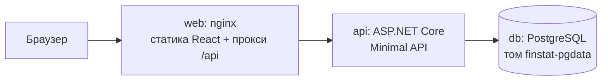
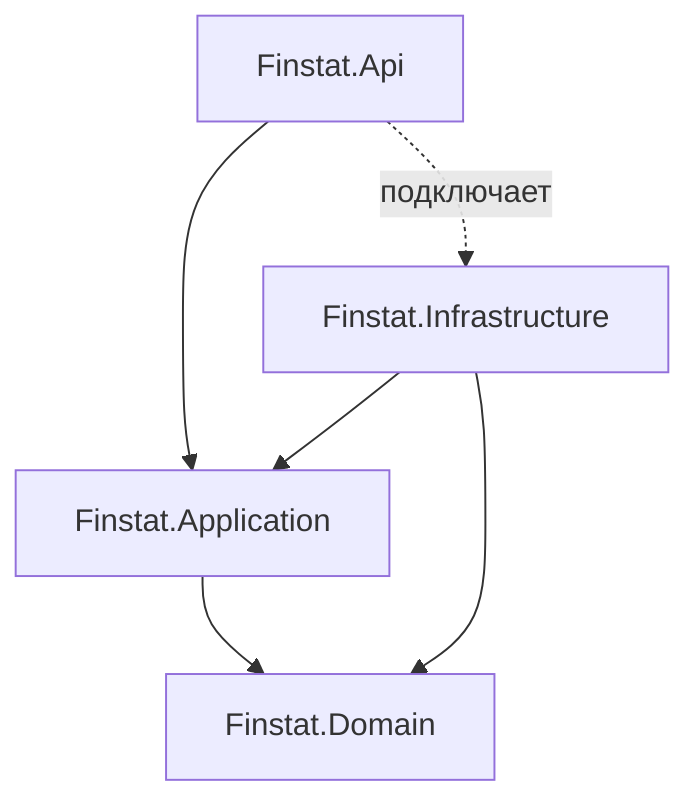

# finstat

Трекер личных расходов (MVP, учебный проект). Расходы записываются вручную по категориям, а приложение показывает, сколько потрачено за месяц и на что, графиком и таблицей. UI на украинском, код и коммиты на английском. Решения: `docs/`.

## Что умеет

- Добавлять, изменять и удалять расходы: сумма в гривнах, категория, дата (по умолчанию сегодня), необязательный комментарий.
- Вести свои категории: добавлять, переименовывать, отправлять в архив. Архивная категория остаётся в истории и статистике, но новые расходы в неё не записываются.
- Показывать любой месяц: итог, самую затратную категорию, три последние операции, кольцо долей и таблицу сумм по категориям.

## Скриншоты

| Огляд | Витрати | Категорії |
| --- | --- | --- |
|  |  |  |

## Запуск одной командой

Нужен только Docker (Docker Desktop на Windows и macOS).

```
cp .env.example .env     # задайте POSTGRES_PASSWORD
docker compose up --build
```

Пароль не должен содержать `;` и `'`: он подставляется в строку подключения. Первая сборка образов занимает несколько минут.

Приложение: http://localhost:3000. API: http://localhost:8080 (`/health`). PostgreSQL хранится в именованном томе `finstat-pgdata`, поэтому данные переживают перезапуск контейнеров.
Остановка: `docker compose down`. Флаг `-v` удаляет данные — только осознанно.
Порты хоста меняются через `WEB_PORT`, `API_PORT` и `DB_PORT` в `.env` (если порт 5432 занят локальным PostgreSQL, укажите, например, `DB_PORT=5433`).

При первом запуске уже есть категории «Їжа» и «Комунальні послуги».

## Архитектура



Браузер ходит только на `web`: тот же origin отдаёт интерфейс и проксирует `/api/` на бэкенд, поэтому CORS не нужен.

### Бэкенд: слои DDD



- **Domain** — модель и правила без внешних зависимостей. Агрегаты `Category` и `Expense`; расход ссылается на категорию по идентификатору. Объект-значение `Money` хранит сумму в `decimal`: только положительная, не больше двух знаков после запятой, лишняя точность отвергается, а не округляется. Состояние меняется только методами (`Rename`, `Archive`, `Change`), публичных setters нет.
- **Application** — сценарии: `CategoryService`, `ExpenseService`, `StatisticsService`. Здесь проверяется, например, уникальность названия категории и то, что новый расход не попадает в архивную категорию. Интерфейсы хранения (`ICategoryRepository`, `IExpenseRepository`, `IStatisticsQuery`) объявлены здесь же.
- **Infrastructure** — EF Core (Npgsql), конфигурация маппинга, миграции и реализации интерфейсов. Статистика месяца считается агрегацией в SQL, без загрузки всех расходов.
- **Api** — HTTP-эндпоинты под `/api`, явные DTO, ошибки в формате Problem Details. Обработчики вызывают сценарии и не содержат бизнес-правил.

### Фронтенд

React + TypeScript (strict) + Vite, код разложен по разделам приложения: `features/overview`, `features/expenses`, `features/categories`. Общие компоненты — в `ui/`, собственные, без сторонней библиотеки; клиент API — в `api/`. Деньги на фронтенде остаются точными десятичными строками и форматируются `Intl.NumberFormat('uk-UA')`; итоги и доли считает бэкенд. Подробнее — `frontend/README.md`.

## Структура backend (`backend/`)

- `src/Finstat.Domain` — сущности и инварианты, без внешних зависимостей.
- `src/Finstat.Application` — сценарии использования (зависит от Domain).
- `src/Finstat.Infrastructure` — EF Core (Npgsql), `FinstatDbContext`, миграции.
- `src/Finstat.Api` — Minimal API, Problem Details, `/health`.
- `tests/Finstat.Tests` — xUnit; интеграционные тесты на реальной PostgreSQL (Testcontainers).

## Локальная разработка

БД из Compose, API локально:

```
docker compose up -d db
cd backend/src/Finstat.Api
dotnet user-secrets set "ConnectionStrings:Finstat" "Host=localhost;Port=5432;Database=finstat;Username=finstat;Password=<пароль из .env>"
dotnet run
```

(порт в строке подключения — `DB_PORT` из `.env`.) Профиль `http` слушает http://localhost:8080 в режиме Development:
OpenAPI — `/openapi/v1.json`, Scalar UI — `/scalar`. В Docker-образе эти адреса отключены.

Строка подключения обязательна: `ConnectionStrings:Finstat` (env `ConnectionStrings__Finstat`), иначе API не стартует.

Фронтенд локально (API на http://localhost:8080):

```
cd frontend
npm ci
npm run dev
```

Dev-сервер: http://localhost:5173, запросы `/api` он проксирует на бэкенд.

## Проверки

Бэкенд, из `backend/` (для тестов нужен запущенный Docker):

```
dotnet build
dotnet test
```

Фронтенд, из `frontend/`:

```
npm run typecheck
npm run lint
npm test
npm run build
```

Сквозной браузерный тест основного сценария (добавить расход → итог и статистика обновились → данные пережили перезапуск контейнеров), против запущенного `docker compose up`:

```
cd frontend
npm run test:e2e
```

## Миграции

Применяются автоматически при старте API (`Database.MigrateAsync`). Новая миграция (из `backend/`):

```
dotnet tool restore
dotnet ef migrations add <Name> -p src/Finstat.Infrastructure -s src/Finstat.Infrastructure -o Migrations
```

Удалить последнюю ещё не применённую миграцию: та же команда с `migrations remove --force` (инструмент не подключается к БД, поэтому без `--force` не может проверить, применена ли она).
