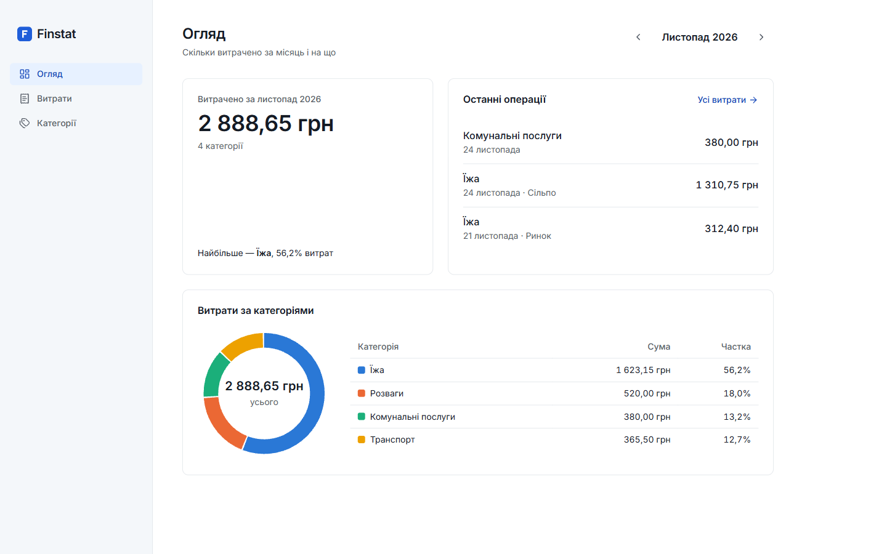
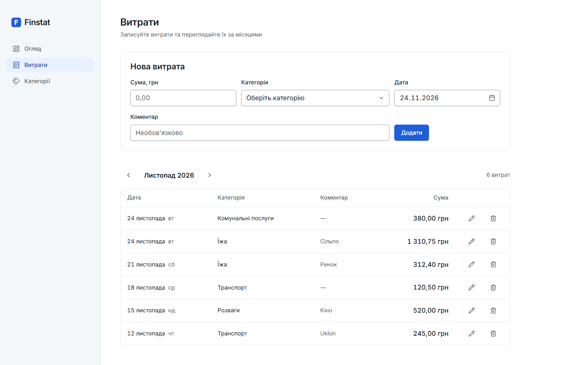
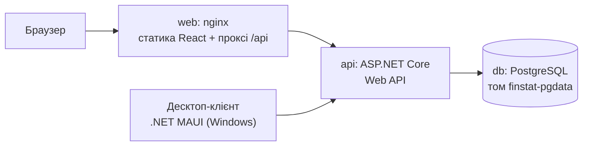
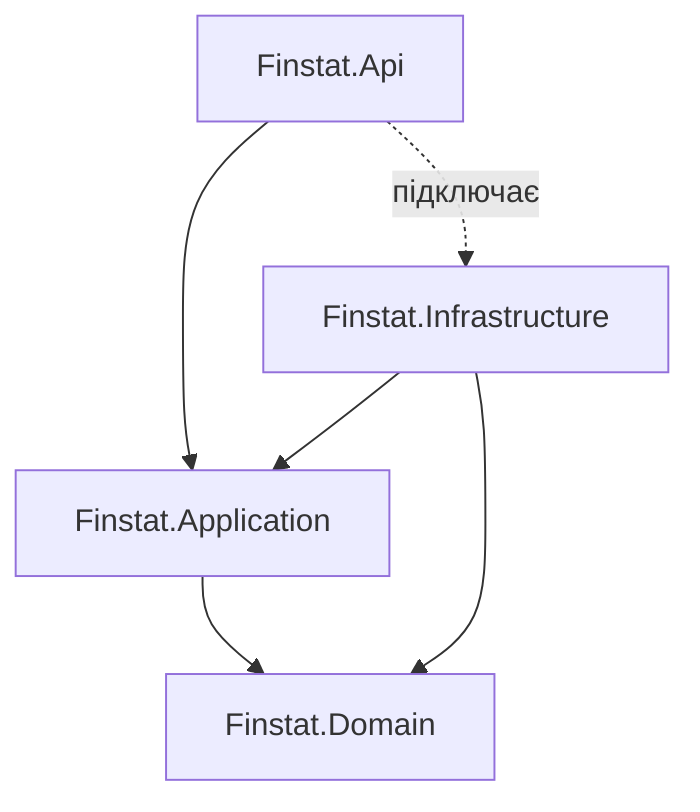

# finstat

Трекер особистих витрат (MVP, навчальний проєкт). Витрати записуються вручну за категоріями, а застосунок показує графіком і таблицею, скільки витрачено за місяць і на що. Інтерфейс українською, код і коміти англійською. Рішення: `docs/`.

## Що вміє

- Додавати, змінювати й видаляти витрати: сума в гривнях, категорія, дата (за замовчуванням сьогодні), необов'язковий коментар.
- Вести власні категорії: додавати, перейменовувати, відправляти в архів. Архівна категорія лишається в історії та статистиці, але нові витрати в неї не записуються.
- Показувати будь-який місяць: підсумок, найвитратнішу категорію, три останні операції, кільце часток і таблицю сум за категоріями.

## Скриншоти

**Огляд**: підсумок місяця, останні операції, частки категорій:



**Витрати**: форма і список за обраний місяць:



**Категорії**: активні та архів:


**Десктоп-клієнт** (Windows, .NET MAUI) повторює ті самі екрани: `docs/screenshots/desktop-overview.png`, `desktop-expenses.png`, `desktop-categories.png`.


## Запуск однією командою

Потрібен лише Docker (Docker Desktop на Windows і macOS).

Один раз скопіюйте `.env.example` у `.env` і задайте в ньому `POSTGRES_PASSWORD` (у cmd: `copy .env.example .env`, у PowerShell і bash: `cp .env.example .env`). Далі весь застосунок запускається однією командою:

```
docker compose up --build
```

Пароль не повинен містити `;` і `'`: він підставляється в рядок підключення. Перше збирання образів триває кілька хвилин.

Застосунок: http://localhost:3000. API: http://localhost:8080 (`/health`). PostgreSQL зберігається в іменованому томі `finstat-pgdata` (Docker додає до назви префікс проєкту за назвою теки, наприклад `finstat_finstat-pgdata`), тому дані переживають перезапуск і перестворення контейнерів.
Зупинка: `docker compose down`. Прапорець `-v` видаляє дані, тож лише свідомо.
Порти хоста змінюються через `WEB_PORT`, `API_PORT` і `DB_PORT` у `.env` (якщо порт 5432 зайнятий локальним PostgreSQL, вкажіть, наприклад, `DB_PORT=5433`).

Під час першого запуску вже є категорії «Їжа» і «Комунальні послуги».

## Архітектура



Браузер звертається лише до `web`: той самий origin віддає інтерфейс і проксує `/api/` на бекенд, тому CORS не потрібен. Десктоп-клієнт звертається до API напряму; CORS перевіряє лише браузер, тому й для нього бекенд не змінюється.

### Бекенд: шари DDD



- **Domain**: модель і правила без зовнішніх залежностей. Агрегати `CategoryEntity` і `ExpenseEntity`; витрата посилається на категорію за ідентифікатором. Сума має тип `decimal`, перевірка в `ExpenseEntity`: лише додатна, не більше двох знаків після коми, зайва точність відкидається з помилкою, а не округлюється. Стан змінюється лише методами (`Rename`, `Archive`, `Change`), публічних setters немає.
- **Application**: сценарії `CategoryService`, `ExpenseService`, `StatisticsService`. Тут перевіряється, наприклад, унікальність назви категорії і те, що нова витрата не потрапляє в архівну категорію. Інтерфейси зберігання (`ICategoryRepository`, `IExpenseRepository`) оголошені тут же.
- **Infrastructure**: EF Core (Npgsql), конфігурація маппінгу, міграції та реалізації інтерфейсів. Статистика місяця рахується агрегацією в SQL, без завантаження всіх витрат.
- **Api**: контролери під `/api` (`categories`, `expenses`, `statistics`), явні DTO, помилки у форматі Problem Details. Контролери викликають сценарії й не містять бізнес-правил.

### Фронтенд

React + TypeScript (strict) + Vite. Код розкладено за розділами застосунку: `features/overview`, `features/expenses`, `features/categories`. Оболонка застосунку лежить у `app/`, спільні утиліти (дати, гроші, вибраний місяць) у `shared/`, власні компоненти без сторонньої бібліотеки в `ui/`, клієнт API в `api/`. Гроші на фронтенді лишаються точними десятковими рядками й форматуються `Intl.NumberFormat('uk-UA')`; підсумки й частки рахує бекенд. Докладніше: `frontend/README.md`.

### Десктоп-клієнт

.NET MAUI для Windows, нативні контроли на XAML. Моделі представлень, клієнт API і форматування винесені в `Finstat.Desktop.Core` без залежності від MAUI й покриті тестами. Суми приходять рядками й лише форматуються; підсумки й частки рахує бекенд. Докладніше: `docs/technical-decisions.md`.

## Структура backend (`backend/`)

- `src/Finstat.Domain`: `Entities/`, `Results/`, сутності й інваріанти без зовнішніх залежностей.
- `src/Finstat.Application`: `Services/`, `DTOs/`, `Repositories/`, сценарії використання (залежить від Domain).
- `src/Finstat.Infrastructure`: `Repositories/`, `Configurations/`, EF Core (Npgsql), `FinstatDbContext`, міграції.
- `src/Finstat.Api`: `Controllers/`, `Helpers/`, контролери, Problem Details, `/health`.

## Структура desktop (`desktop/`)

- `src/Finstat.Desktop.Core`: `DTOs/`, `Api/`, `Formatting/`, `ViewModels/`, контракт API, клієнт на `HttpClient`, форматування `uk-UA`, моделі представлень.
- `src/Finstat.Desktop`: застосунок MAUI, `MainPage` з меню, `Views/` (Огляд, Витрати, Категорії), `Controls/` (кільце, перемикач місяця, стани), `Resources/` (кольори, стилі, шрифт Inter, іконки).
- `tests/Finstat.Desktop.Tests`: xUnit v3, форматування, розбір суми, клієнт API, введення витрати й оновлення статистики.

## Локальна розробка

Потрібні .NET SDK 10 (версія зафіксована в `backend/global.json` і `desktop/global.json`), Node.js 22.13+ або 24 і Docker для бази.

БД з Compose, API локально:

```
docker compose up -d db
cd backend/src/Finstat.Api
dotnet user-secrets set "ConnectionStrings:Finstat" "Host=localhost;Port=5432;Database=finstat;Username=finstat;Password=<пароль з .env>"
dotnet run
```

(порт у рядку підключення береться з `DB_PORT` у `.env`.) Профіль `http` слухає http://localhost:8080 у режимі Development:
OpenAPI на `/openapi/v1.json`, Swagger UI на `/swagger`. У Docker-образі ці адреси вимкнені.

Рядок підключення обов'язковий: `ConnectionStrings:Finstat` (env `ConnectionStrings__Finstat`), інакше API не стартує.

Фронтенд локально (API на http://localhost:8080):

```
cd frontend
npm ci
npm run dev
```

Dev-сервер: http://localhost:5173, запити `/api` він проксує на бекенд.

Десктоп-клієнт (лише Windows 10 1809 і новіші). Один раз встановіть навантаження MAUI, потрібні права адміністратора:

```
dotnet workload install maui-windows
```

Запуск (API має працювати на http://localhost:8080, наприклад через `docker compose up --build`):

```
cd desktop
dotnet run --project src/Finstat.Desktop
```

Іншу адресу API задає змінна `FINSTAT_API_URL`, наприклад у PowerShell: `$env:FINSTAT_API_URL = "http://localhost:8081"`.

## Перевірки

Бекенд, з `backend/`:

```
dotnet build
```

Фронтенд, з `frontend/`:

```
npm run typecheck
npm run lint
npm test
npm run build
```

Десктоп-клієнт, з `desktop/`:

```
dotnet build
dotnet test
```

Наскрізний браузерний тест основного сценарію (додати витрату → підсумок і статистика оновилися → дані пережили перестворення контейнерів) проти запущеного `docker compose up`:

```
cd frontend
npm ci
npm run test:e2e
```

Потрібен встановлений Google Chrome; без нього виконайте `npx playwright install chromium` і задайте змінну `E2E_BROWSER_CHANNEL=chromium`. Тест додає одну витрату й видаляє її наприкінці. Докладніше: `frontend/README.md`.

## Міграції

Застосовуються автоматично під час старту API (`Database.MigrateAsync`). Нова міграція (з `backend/`):

```
dotnet tool restore
dotnet ef migrations add <Name> -p src/Finstat.Infrastructure -s src/Finstat.Infrastructure -o Migrations
```

Видалити останню ще не застосовану міграцію: та сама команда з `migrations remove --force` (інструмент не підключається до БД, тому без `--force` не може перевірити, чи її вже застосовано).
